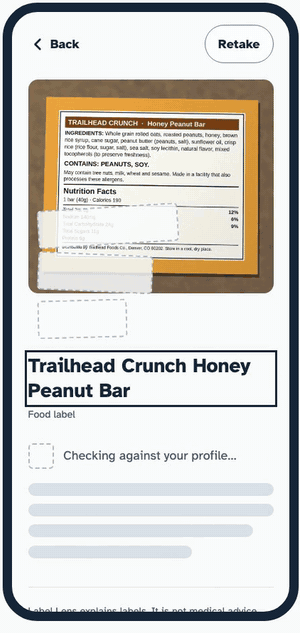
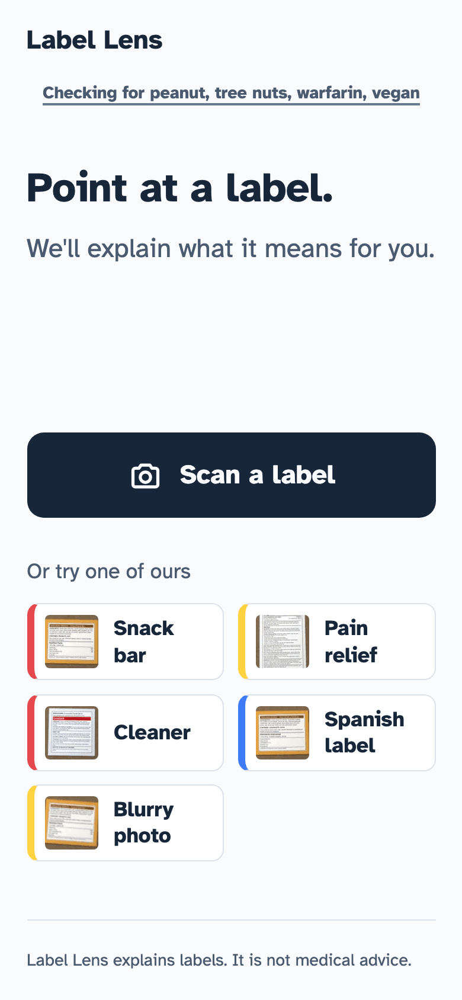
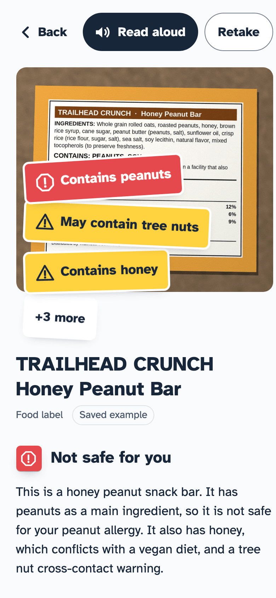
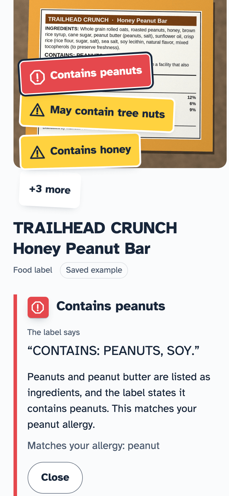

# Label Lens

**Point your phone at any label. Label Lens tells you what it means for *you*: in your language,
read aloud, with every warning backed by the exact words on the label.**

Live demo: https://label-lens-iota.vercel.app · Demo video: https://youtu.be/STqFvowDtD4 · Code: https://github.com/SrujanRudrapati/label-lens

Built for the Devpost hackathon "All U Can Do With AI".

<p align="center">
  
</p>

<table>
  <tr>
    <td align="center" valign="top"><br><sub>Point at a label</sub></td>
    <td align="center" valign="top"><br><sub>Warnings made for you</sub></td>
    <td align="center" valign="top"><br><sub>Every warning quotes the label</sub></td>
  </tr>
</table>

## The problem
Labels are written for the average person, and almost nobody is average. Someone with a peanut
allergy has to read every ingredient line. Someone on warfarin has to know that common pain relievers
can interact with it. Someone who reads Spanish better than English, or who has low vision, may not be able to
read 6-point type at all. The information is printed on the package, but it is hard to find, hard to
read, and never checked against the person holding it.

## What it does
1. **Scan a label.** Take a photo of a medicine box, food package, or household product.
2. **Instant first read.** The product name and label type appear within a couple of seconds.
3. **Stickers.** Warnings land on your photo as colored stickers, like the ones a pharmacist puts on a
   pill bottle: red for danger, yellow for caution, blue for a note. Each one has a short title.
4. **Evidence.** Tap a sticker to see the exact words on the label that triggered it, and why it matters
   to you. If it can't be quoted from the label, it isn't shown.
5. **For you.** Set your allergies, medicines, diet, and language once (optional, skippable). Results
   are checked against them. The profile lives in your browser's localStorage and is never stored on a server.
6. **Read aloud**, in your language, with a matching voice when the device has one.
7. **Ask a question** about the label. The answer streams in.

Languages: English and Spanish. Explanations are in your language, while evidence quotes stay in the label's
original language so you can match them against the package.

## How AI is used
- **Two Claude models in parallel.** `claude-haiku-5-5` gives an instant first read (product name,
  label type, readable or not). `claude-sonnet-5-5` does the full vision analysis on the same image at
  the same time. Haiku's result shows immediately, then Sonnet's fills in. If Haiku says the photo is
  unreadable, the Sonnet request is cancelled and the user is asked to retake it.
- **Structured output.** Sonnet reports through a tool call whose JSON schema is generated from the
  zod schema, so there is one source of truth. Every response is validated with zod. If it fails, the
  issues are fed back to the model for one retry, then the user sees a clear error. (Sonnet 5.5 rejects forced
  `tool_choice`, so the call uses `auto` plus an instruction to call the tool exactly once.)
- **Evidence grounding.** Every flag must carry `evidence`, the exact text read from the label, and
  anything without it is dropped in post-processing. The prompt forbids negative claims
  ("no peanuts printed"). We checked all 44 evidence quotes (20 unique) in the recorded sample
  responses by hand against the label images, and every one appears verbatim.
- **Safety post-processing.** Interaction flags are capped at "caution" and always tell you to confirm
  with a pharmacist. "May contain" cross-contact lines can't be rated as danger, diet conflicts are
  never danger, and a verdict can never be upgraded to "no warnings" because a flag was dropped. Emergency wording in
  a question (swallowed, overdose, poison) is answered with "call emergency services or poison control" before any model is called.
- **Local-only profile.** Your profile is read from localStorage and sent with each scan request so the
  answer fits you. Nothing is stored on a server and there is no account.
- **Follow-up Q&A** uses Haiku with the extracted analysis as context (no image is re-sent) and streams the answer.
- **Prompt caching** on the long system prompts, capped `max_tokens` on every call, and client-side
  downscaling of photos (longest edge 1568 px, JPEG 0.85) before upload.

Sample buttons on the live site replay saved responses recorded from the real models, to control cost;
photos you take use live AI.

## Run it locally
```bash
git clone https://github.com/SrujanRudrapati/label-lens.git && cd label-lens
npm install

# No API key? Run the whole app on recorded sample responses:
MOCK_AI=1 npm run dev

# With a key:
cp .env.example .env.local   # add ANTHROPIC_API_KEY
npm run dev
```
Open http://localhost:3000. In `MOCK_AI=1` mode the sample buttons work with no key, and a real photo
gets a clear "No API key here. Try a sample." message.

Other commands: `npm run build`, `npm run lint`, `npm test` (unit tests), `npm run e2e` (Playwright, runs in mock mode).

## Built with
- [Next.js](https://nextjs.org/) (App Router) and [React](https://react.dev/)
- [TypeScript](https://www.typescriptlang.org/) (strict)
- [Tailwind CSS](https://tailwindcss.com/)
- [Anthropic SDK](https://github.com/anthropics/anthropic-sdk-typescript) with Claude Sonnet 5.5 and Claude Haiku 5.5
- [zod](https://zod.dev/) for validating every model response and request
- [Web Speech API](https://developer.mozilla.org/en-US/docs/Web/API/Web_Speech_API) (speechSynthesis) for Read aloud
- [Atkinson Hyperlegible](https://fonts.google.com/specimen/Atkinson+Hyperlegible) (Braille Institute, designed for low-vision readers)
- [Vercel](https://vercel.com/) for hosting
- [Vitest](https://vitest.dev/) and [Playwright](https://playwright.dev/) for tests

## What we didn't build ourselves
- The open-source libraries, fonts, and APIs listed above.
- The Claude models (Anthropic) that read and explain the labels.
- The sample label images are fictional products that were generated for this project. They are not real products.
- Built with [Claude Code](https://claude.com/claude-code), using the MIT-licensed ECC configuration
  (agents and rules) and Anthropic's frontend-design skill. All application code was written during the hackathon.

## Team
Srujan

## Disclaimer
Label Lens explains labels. It is not medical advice. Always confirm medication questions with a
pharmacist or doctor. In an emergency, call your local emergency services or poison control.
